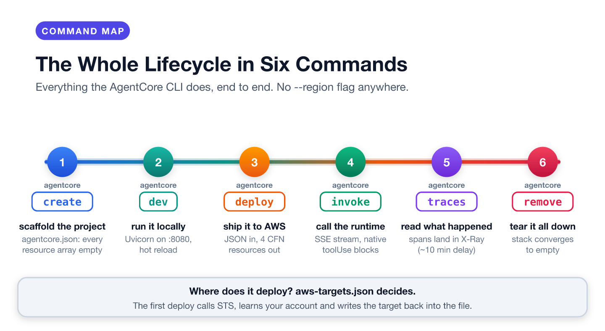
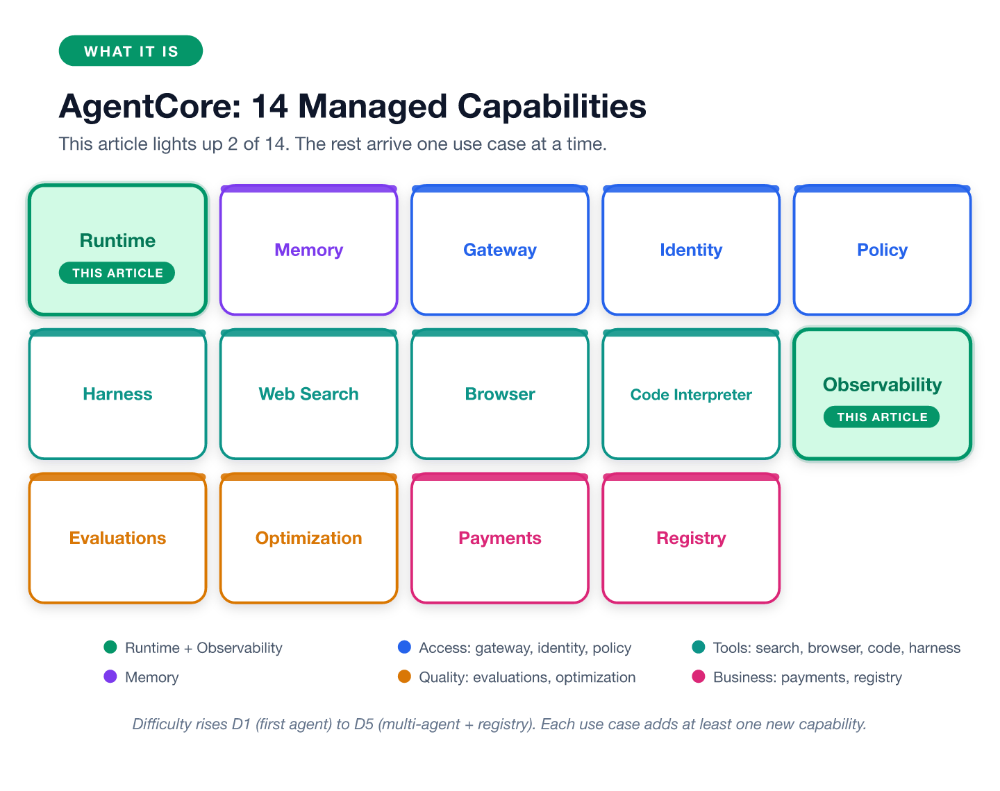
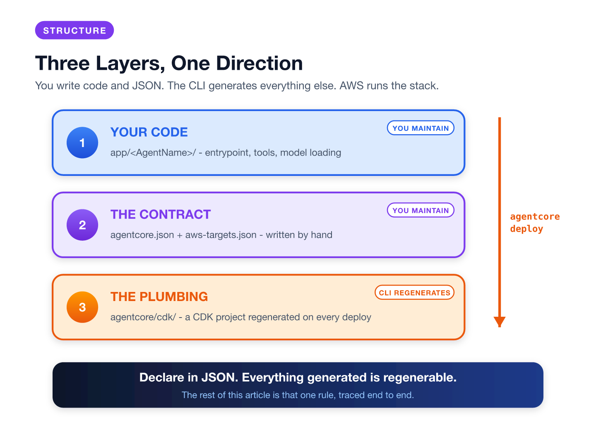
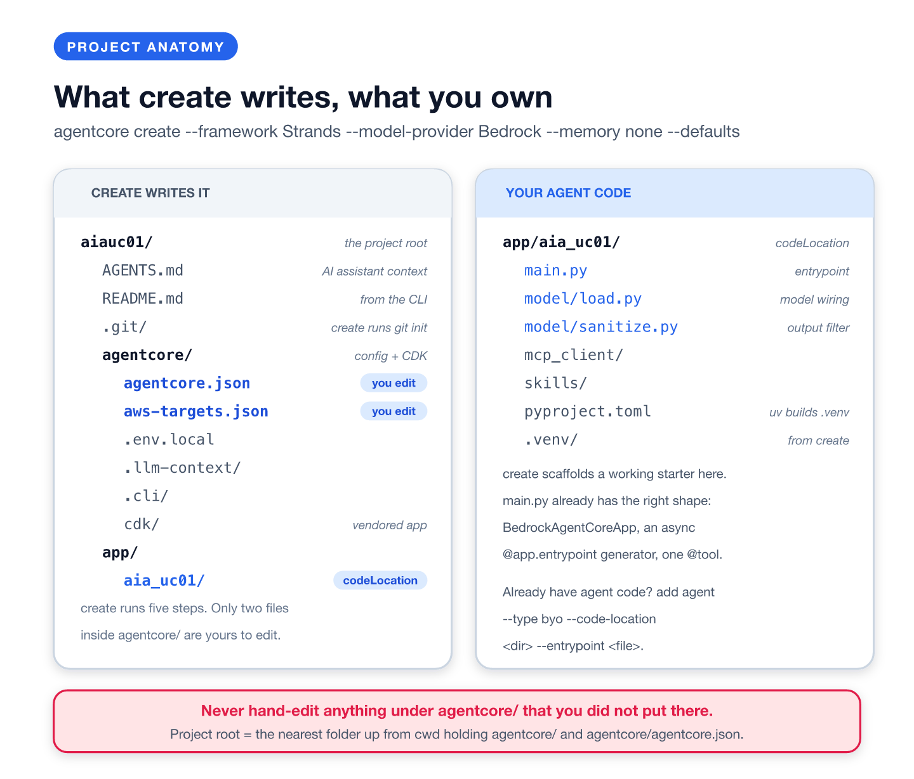
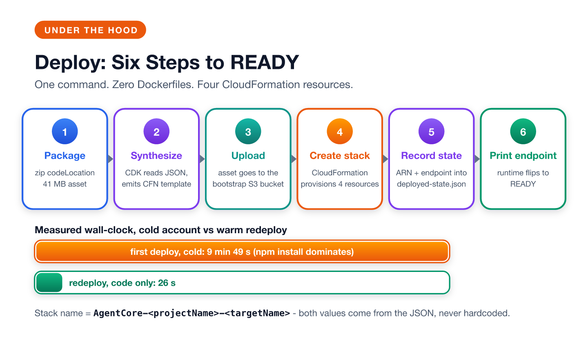
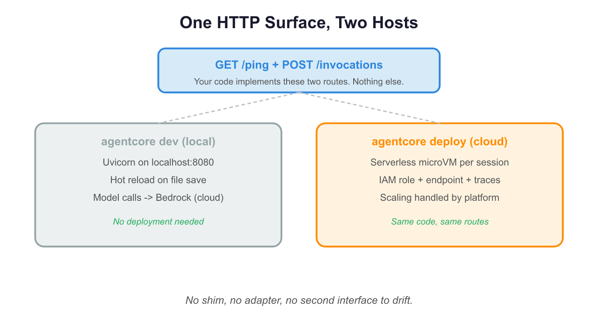
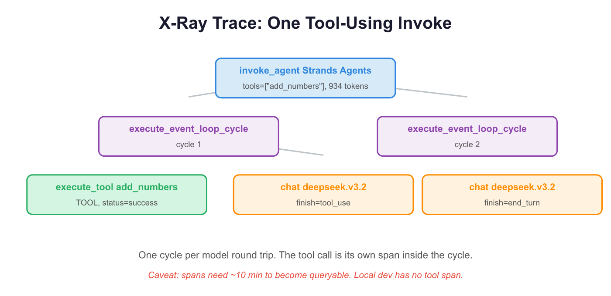

Most agent deployment stories end the same way: write a Dockerfile, pick an instance size, hand-roll an IAM role and hope the YAML is right. AWS Bedrock AgentCore takes a different path: the entire deployment contract is one JSON file, and one command turns it into a running, observable endpoint.

This article walks that path once and explains what happens under the hood. Every command and output below comes from a real deployment in us-east-1, not from the docs.



## What AgentCore is and what it is not

AgentCore is a family of managed runtimes for AI agents: 14 capabilities covering hosting, memory, access control, tools, quality and business integration. This article lights up two of them, the runtime and observability.



What it is not matters more than what it is:

- **Not a new agent framework.** You still write your agent in Strands, LangChain, the OpenAI SDK or raw Python.
- **Not container orchestration.** Each session gets its own microVM and the platform handles scaling.
- **Not a model router.** Your code calls Bedrock the way it would anywhere else.

AgentCore hosts that code and adds three things: an HTTP endpoint, an IAM role and a trace pipeline. Coming from ECS or Fargate, the short version is: no Dockerfile, no task definition, no target group.

## Three layers, one direction

You write agent code. You write two JSON files. The CLI generates everything else. AWS runs a CloudFormation stack that you never have to look at.



| Layer | What lives there | Who maintains it |
|---|---|---|
| Your code | `app/<AgentName>/` with the agent entrypoint | you |
| The contract | `agentcore.json` and `aws-targets.json` | you, by hand |
| The plumbing | a CDK project under `agentcore/cdk/` | the CLI, on every deploy |

One rule explains most of the design: everything you declare lives in JSON, and everything the CLI generates is regenerable. The rest of this article traces that one rule end to end.

## The environment you need

Before touching AgentCore, make sure your machine and account match this table. Everything here was verified on 2026-10-14 and 2026-10-15.

| Tool | Version used | Notes | Check |
|---|---|---|---|
| Node.js | 22.x | 20+ required by the CLI | `node --version` |
| AgentCore CLI | 0.31.1 | install below | `agentcore --version` |
| AWS CLI | 2.x | any recent build | `aws --version` |
| uv | 0.11.9 | the CLI builds the Python environment for template agents with it | `uv --version` |
| Git | 2.39 | `create` runs `git init` in the new project | `git --version` |
| Python | 3.11 local | 3.10 to 3.14 supported by CodeZip | `python3 -V` |
| AWS account | any | with permissions below | `aws sts get-caller-identity` |
| Region | us-east-1 | the whole series uses it | `aws configure get region` |
| Docker | not needed | this series uses CodeZip builds | n/a |

Install the CLI and point AWS at the right region:

```bash
npm install -g @aws/agentcore@latest
aws configure set region us-east-1
```

Then run the checks below and compare against this output:

```bash
node --version
# v22.22.2

uv --version
# uv 0.11.9

git --version
# git version 2.39.5

agentcore --version
# 0.31.1

aws sts get-caller-identity --query '[Account,Arn]' --output text
# 123456789012    arn:aws:iam::123456789012:user/yourname

aws configure get region
# us-east-1

aws bedrock list-foundation-models --region us-east-1 \
  --query 'modelSummaries[?modelId==`deepseek.v3.2`].modelId' --output text
# deepseek.v3.2
```

**Permissions.** Two identities are involved, and they are easy to confuse:

- *You*, the deployer, need enough to create CloudFormation stacks, upload to the CDK bootstrap bucket and manage AgentCore resources. On a sandbox account, admin is the honest shortcut. On a locked-down account the CLI fails loudly and names the missing action, so you can grant incrementally.
- *The runtime* gets an IAM role the CLI generates for you. Mine carried three permission groups: `bedrock:InvokeModel*`, `logs:*` for the group under `/aws/bedrock-agentcore/runtimes/`, and `xray:PutTraceSegments`. That generated policy is a good least-privilege template later.

One trap worth five seconds: if `agentcore --version` errors but the command exists, an old Python package (`bedrock-agentcore-starter-toolkit`) is shadowing the npm one. `pip uninstall bedrock-agentcore-starter-toolkit` fixes it.

> **📸 Screenshot spot 1 · Environment check**
> Capture one full terminal screen: the prompt, the checks above, their output and the clock. The table is the exact list; the shot is evidence of the machine you actually ran it on.

## Step 1 · Scaffold the project

One command builds the whole project. This is the CLI's own getting-started form, with this article's names:

```bash
agentcore create --name aia_uc01 --project-name aiauc01 \
  --framework Strands --model-provider Bedrock --memory none --defaults
```

```text
[done]  Create aiauc01/ project directory
[done]  Prepare agentcore/ directory
[done]  Initialize git repository
[done]  Add agent to project
[done]  Set up Python environment

Created:
  aiauc01/
    app/aia_uc01/  Python agent (Strands)
    agentcore/     Config and CDK project

Project created successfully!

To continue, navigate to your new project:

  cd aiauc01
  agentcore
```

Five steps, and the interesting part is what lands on disk:



`create` writes three things. The project root gets `AGENTS.md`, a `README.md` and a `git init`. The `agentcore/` directory gets the contract, the targets file, `.env.local` for secrets, `.llm-context/` type definitions for AI assistants, `.cli/` state, and the vendored `cdk/` app. And `app/aia_uc01/` gets a starter agent: `main.py` with the `BedrockAgentCoreApp` wiring and a `@tool` example, `model/load.py` for model instantiation, `pyproject.toml`, and a Python environment the CLI builds with uv. The contract records precisely that location (`codeLocation: "app/aia_uc01/"`, `entrypoint: "main.py"`), which is also the CLI's documented App Structure.

The starter is not a toy you throw away. Its `main.py` already has the shape the runtime wants, so this article's agent keeps the scaffolding and swaps in its own system prompt, tool and model loader. Wherever your agent code ends up living, one rule holds: whatever `codeLocation` names is what gets zipped, deployed and started by `agentcore dev`. (Already have agent code elsewhere? `agentcore add agent --type byo --code-location <dir> --entrypoint <file>` points the same two fields at it.)

Two facts about this layout will save you an hour someday:

- Inside `agentcore/`, only two files are truly yours to edit: `agentcore.json` and `aws-targets.json`. Everything else there is regenerable, and the next command overwrites it.
- Project detection is strict: the CLI walks up from your current directory until it finds a folder holding both `agentcore/` and `agentcore/agentcore.json`. Either one alone is not a project, and the error (`No agentcore project found`) does not say which is missing.

Peek inside the generated contract and you will see the shape of the design: `agentcore.json` declares fourteen resource arrays, thirteen of them empty, and `aws-targets.json` is just `[]`. You are about to fill both in.

> **📸 Screenshot spot 2 · Project scaffold**
> Capture the tree in your editor (the `agentcore/` and `app/` folders expanded in the sidebar), not a plain terminal listing. The point is to show which entries are folders, which are files, and which ones you will edit.

## Step 2 · Write the contract: two JSON files

Here is the whole deployment definition for my test agent, trimmed to the fields that matter:

```json
{
  "$schema": "https://schema.agentcore.aws.dev/v1/agentcore.json",
  "name": "aiauc01",
  "version": 1,
  "managedBy": "CDK",
  "runtimes": [
    {
      "name": "aia_uc01",
      "build": "CodeZip",
      "entrypoint": "main.py",
      "codeLocation": "app/aia_uc01/",
      "runtimeVersion": "PYTHON_3_13",
      "networkMode": "PUBLIC",
      "protocol": "HTTP",
      "envVars": [{ "name": "MODEL_ID", "value": "deepseek.v3.2" }]
    }
  ],
  "memories": [],
  "knowledgeBases": [],
  "agentCoreGateways": []
}
```

`create` writes this file with every resource array empty. The `agentcore add` family (`add agent`, `add memory`, `add gateway`) then pushes entries in. Hand edits are allowed, but the published schema is the authority because the CLI validates every field against it.

Four fields in that runtime block are the ones you cannot get wrong without a failed deploy: `entrypoint` (the file the platform calls), `codeLocation` (`app/aia_uc01/`), `build` (`CodeZip`, which means no container) and `protocol` (`HTTP`). The rest have defaults. `envVars` is how `MODEL_ID` reaches your code, so switching models is a JSON edit rather than a code change.

One naming detail confused me for a while: the project is `aiauc01` (the top-level `name` field) and the runtime is `aia_uc01` (`runtimes[].name`). CloudFormation names things after both, which is why the deployed runtime ID came out as `aiauc01_aia_uc01-LH8zQV86C2`.

Before deploying, ask the CLI whether the contract is even valid:

```bash
agentcore validate
# Valid
```

That is the same schema check deploy runs in its `Validate project` step, in about a second instead of after a two-minute build.

The second file decides where the deployment lands:

```json
[
  { "name": "default", "account": "123456789012", "region": "us-east-1" }
]
```

Here is the part that surprised me. `create` writes only an empty array. The first `deploy` fills it in: it calls STS, learns who you are and writes the target back into the file. There is no `--region` flag on deploy, status or remove, so the file is the only source of truth for where your agent lands.

## Step 3 · Deploy: one command, six steps

Now the moment the whole article is named after. From the project root:

```bash
agentcore deploy -y --target default
```

Real output, first deploy ever on a cold account:

```text
✓ Load deployment target
✓ Validate project
✓ Sync CDK dependencies
✓ Build CDK project
✓ Synthesize CloudFormation
✓ Check bootstrap status
✓ Check stack status
✓ Deploy to AWS
✓ Persist deployment state
✓ Deployed to 'default' (stack: AgentCore-aiauc01-default)
  ApplicationAgentAiaUc01RuntimeIdOutput734A07B7: aiauc01_aia_uc01-LH8zQV86C2
  ApplicationAgentAiaUc01RuntimeArnOutput3227EF65: arn:aws:bedrock-agentcore:us-east-1:123456789012:runtime/aiauc01_aia_uc01-LH8zQV86C2
```

Between the command and the last checkmark, six things happen:



1. **Package the code.** The CLI zips whatever `codeLocation` names, with platform dependencies, into one asset. My hello-world agent produced a 41 MB zip; the local `.venv` is excluded. No image is built anywhere in the project.
2. **Synthesize.** The vendored CDK app (`node dist/bin/cdk.js`) reads both JSON files and emits a CloudFormation template into `cdk.out/`.
3. **Upload the asset.** The zip lands in the S3 bucket that `cdk bootstrap` created once per account and region. Without that one-time bootstrap, no CDK deployment can store an asset.
4. **Create the stack.** CloudFormation provisions four resources: the runtime, an IAM role for it, a Bedrock model-access policy and a CDK metadata resource.
5. **Record the state.** The CLI writes `agentcore/.cli/deployed-state.json` with the runtime ARN and endpoint.
6. **Print the endpoint.**

Step 2 is where schema-first becomes visible. The generated app reads your files by path and carries no project knowledge of its own:

```ts
// agentcore/cdk/bin/cdk.ts, verbatim from the generated project
async function main() {
  // Config root is parent of cdk/ directory. The CLI sets process.cwd() to agentcore/cdk/.
  const configRoot = path.resolve(process.cwd(), '..');
  const configIO = new ConfigIO({ baseDir: configRoot });

  const spec = await configIO.readProjectSpec();             // agentcore.json
  const targets = await configIO.readAWSDeploymentTargets(); // aws-targets.json
  ...
}
```

The stack name also comes from the JSON (`AgentCore-<projectName>-<targetName>`, mine was `AgentCore-aiauc01-default`) and grepping the generated project for hard-coded names returns zero hits. The same TypeScript synthesizes a different stack for any JSON you feed it: `cdk/` is a compiler and `agentcore.json` is the program.

Timings, because every tutorial skips them: the first deploy on a cold account took 9 minutes 49 seconds, mostly `npm install` for the CDK project, the asset upload and the stack create. A code-only redeploy took 26 seconds, because the stack already exists and only the asset hash changes. Verify with `agentcore status`, which reports `Runtime: READY` plus the endpoint URL.

> **📸 Screenshot spot 3 · First deploy**
> Capture the progress lines with their timestamps, not just the final ARN block. The cold-start wait is the part readers underestimate.

## Step 4 · Run the same code locally

Before (or without) deploying, `agentcore dev` starts the same app under Uvicorn on `localhost:8080`, serving the same two routes. Model calls still go to Bedrock, so you need credentials but no deployment. I run it with `-l`, which keeps it a plain server with logs on stdout; without flags it opens a browser chat UI instead:

```bash
agentcore dev -l
# (in another terminal)
curl -s -X POST http://localhost:8080/invocations \
  -H 'Content-Type: application/json' \
  -d '{"prompt":"What is 128 plus 256? Use the tool."}'
```

Read the stream rather than the last line: you should see `toolUse` with `name: add_numbers`, and then a second message carrying the answer `384`. If the tool is never called, the problem is your prompt or the tool docstring, not the platform. Three more flags earn their keep: `-p` when 8080 is taken, `-b` for a terminal UI when you would rather stay in the shell, and `--skip-deploy` to stop the server from deploying the resources your project declares.

The loop is fast. I edited `main.py` while the server ran and watched the reloader pick the change up without a restart.

> **📸 Screenshot spot 4 · Local run**
> Capture the `agentcore dev` boot banner plus one hot-reload line, so readers see the reloader react to a file save. The curl reply is already quoted above.

## Step 5 · Invoke the deployed runtime

The deployed runtime answers through the data plane. The CLI wraps it with a friendly command:

```bash
agentcore invoke --prompt "What is 17 plus 25? Use the tool."
```

```text
I'll use the addition tool to calculate the sum of 17 and 25.

17 plus 25 equals 42.

Session: 53451706-bd56-43f3-84ef-1eceaa3c2aee
To resume: agentcore invoke --session-id 53451706-bd56-43f3-84ef-1eceaa3c2aee
Log: .../agentcore/.cli/logs/invoke/invoke-aia_uc01-20261014-153601.log
```

The same prompt against the raw data plane (boto3 `invoke_agent_runtime`) returns the SSE stream, and the tool call is not hidden inside it:

```text
data: {"event": {"contentBlockStart": {"start": {"toolUse": {"toolUseId": "tooluse_V8T0pNRzrKLCyUR7wmvlVd", "name": "add_numbers"}}, "contentBlockIndex": 1}}}
data: {"event": {"contentBlockDelta": {"delta": {"toolUse": {"input": "{\"a\": 11, \"b\": 31}"}}, "contentBlockIndex": 1}}}
data: {"event": {"messageStop": {"stopReason": "tool_use"}}}
data: {"event": {"messageStart": {"role": "assistant"}}}
data: {"event": {"contentBlockDelta": {"delta": {"text": "11 plus 31 equals 42."}, "contentBlockIndex": 0}}}
data: {"event": {"messageStop": {"stopReason": "end_turn"}}}
data: {"event": {"metadata": {"usage": {"inputTokens": 471, "outputTokens": 9, "totalTokens": 480}, "metrics": {"latencyMs": 820}}}}
```



"One surface" is the two routes your code implements: `GET /ping` and `POST /invocations`. "Two hosts" are the environments that serve them: Uvicorn on `localhost:8080` under `agentcore dev`, and a managed microVM behind `https://bedrock-agentcore.<region>.amazonaws.com/runtimes/<runtime-arn>/invocations` in the cloud. Routing, scaling and TLS stay on the platform side, so your code never learns which host it is on. `agentcore invoke` is not a third interface; it is a CLI client for the hosted `/invocations`, the same way boto3 is. Tool calls ride on native Bedrock `toolUse` blocks in both hosts, so there is no new tool protocol to learn.

What did that cost? DeepSeek V3.2 in us-east-1 charges $0.62 per million input tokens and $1.85 per million output. A two-cycle invoke used 846 input and 82 output tokens: about $0.0007 of model calls plus $0.0002 of runtime compute. For a tutorial-grade agent, the infrastructure bill rounds to zero.

> **📸 Screenshot spot 5 · Cloud invoke**
> Capture the invoke screen with the runtime ARN and the session ID both visible, so readers can tell this call hit the deployed endpoint and not localhost.

## Under the hood I: the HTTP contract

Strip away the tooling. The runtime makes exactly two requests to your code: `GET /ping` for health checks and `POST /invocations` for work. `BedrockAgentCoreApp` is a thin adapter that maps those routes onto an async generator you write:

```python
from bedrock_agentcore.runtime import BedrockAgentCoreApp
from strands import Agent, tool

app = BedrockAgentCoreApp()

@tool
def add_numbers(a: int, b: int) -> int:
    """Return the sum of two numbers."""
    return a + b

@app.entrypoint
async def invoke(payload, context):
    session_id = getattr(context, "session_id", "default-session")
    agent = get_or_create_agent(session_id)
    async for event in agent.stream_async(extract_prompt(payload)):
        yield event
```

Three details carry most of the design. (The real file also filters every text delta through a stream sanitizer, which the failure section explains.)

- The entrypoint is an async generator, so streaming is the platform's default shape rather than an add-on: every yielded dict becomes one server-sent event.
- `context.session_id` is the only state key you manage. Each session runs in its own microVM and the platform handles scaling.
- The model is a parameter. `MODEL_ID` arrives as an environment variable declared in `agentcore.json`, and a small module turns it into a Strands `BedrockModel`.

## Under the hood II: what observability records

A deployed invoke produces this span tree in X-Ray. The output is real, including the token counts:

```bash
agentcore traces list          # lists recent traces (2-3 min after the invoke)
agentcore traces get <trace-id>
```



```text
invoke_agent Strands Agents              gen_ai.agent.tools=["add_numbers"]  tokens=934
├── execute_event_loop_cycle  (cycle 1)
│   ├── execute_tool add_numbers         gen_ai.tool.status=success  span_kind=TOOL
│   └── chat  deepseek.v3.2 (LLM, 451 tokens)
│       └── BedrockRuntime ConverseStream   finish_reason=tool_use
└── execute_event_loop_cycle  (cycle 2)
    └── chat  deepseek.v3.2 (LLM, 483 tokens)
        └── BedrockRuntime ConverseStream   finish_reason=end_turn
```

The structure teaches you how the agent loop works without reading framework source: one cycle per model round trip, the tool call as its own span inside the cycle, and a second cycle that consumes the result.

Two caveats come from measuring this. Spans are asynchronous: transaction search took about ten minutes before anything was queryable, so a test that invokes and greps CloudWatch immediately will fail. And local `agentcore dev` traces record tool calls in logs but not as spans. Only the deployed runtime emits the `execute_tool` span, so a smoke test that asserts on a tool span has to run against the deployment.

> **📸 Screenshot spot 6 · Observability**
> Capture the CloudWatch GenAI observability console or the X-Ray trace map with the `execute_tool` span expanded. This is the one thing the text tree above cannot convey: the visual waterfall and where the time went.

## What broke and what it taught

Four failures are worth passing on:

- **Stale `cdk.out` fails the next deploy.** The CLI deletes `cdk.out` before each synth, so leftover state from a previous run can kill it with `Subprocess exited with error 1`. Running `cdk synth` by hand still worked, which is how I knew the project itself was fine. `rm -rf agentcore/cdk/cdk.out` fixed it.
- **Renaming is destroying.** The `name` field becomes the CloudFormation logical ID, so changing it does not rename the runtime. It deletes the old one and creates a new one.
- **The model leaks scaffolding into the text channel.** `deepseek.v3.2` emitted fragments of its internal chat-template markers as ordinary text, and the Nova models emitted `<thinking>` blocks. Calling Bedrock's `converse_stream` with Strands removed proved this was model behavior, not a framework bug: all four models leaked something. The fix is a stream-safe filter in the entrypoint that holds back marker prefixes and resets once per assistant message, because one tool-using turn spans several messages.
- **The region is not a flag.** Every guess at `--region` fails with `unknown option`. The targets file decides.

## Takeaways

1. **The JSON file is the interface.** Everything downstream (the CDK project, the template, the stack) is regenerable plumbing that it drives.
2. **CDK shows up here as a vendored compiler.** You never write constructs and you never edit the generated project. Change the schema and the same code compiles a different stack.
3. **Local and deployed share one HTTP contract.** `/ping` and `/invocations` behave identically, so the code that passed locally deploys without a shim.
4. **Observability is real but asynchronous.** The tool call gets its own span in the cloud and spans take minutes to become queryable. Write your tests accordingly.

One sentence to take away: in AgentCore your infrastructure is not code you maintain. It is code that compiles.

## The setup behind the numbers

All measurements come from one deployment on 2026-10-14: CLI 0.31.1, Node 22, local Python 3.11 (runtime target `PYTHON_3_13`), Strands Agents 1.60.0, `deepseek.v3.2` in us-east-1, CodeZip builds, one hello-world agent with a single `add_numbers` tool. Deploy timings are wall-clock and token counts come from trace spans rather than estimates.

## Screenshot checklist (for publishing)

This article reserves six spots for your own terminal captures. Fill them in after running the steps, then delete this section before publishing. The text outputs stay in the article as the copyable record; each shot is there to show what text cannot:

| Spot | After which step | What to capture | What the text above cannot show |
|---|---|---|---|
| 1 | environment checks | one full terminal screen, prompt and clock included | that this ran on a real machine, with real paths |
| 2 | Step 1 | the tree in the editor sidebar | folders vs files and what you will actually edit |
| 3 | Step 3 | progress lines with timestamps | how long the cold start actually takes |
| 4 | Step 4 | dev boot banner plus a hot-reload line | the reloader reacting to a save |
| 5 | Step 5 | invoke screen with ARN and session ID | that the call hit the endpoint, not localhost |
| 6 | Under the hood II | CloudWatch console or X-Ray trace map, tool span expanded | the visual waterfall and where the time went |
